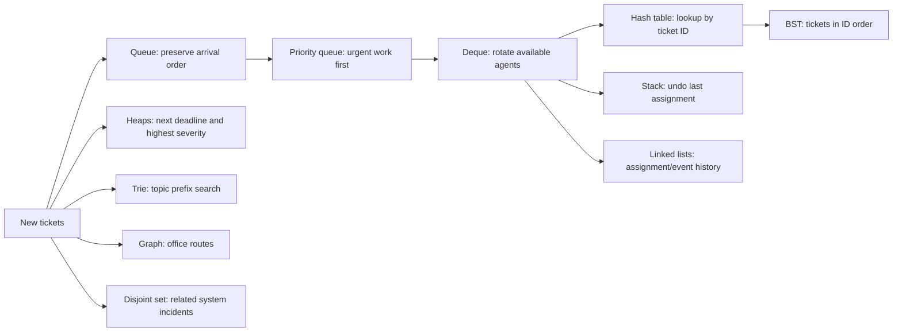

# Data Structures Learning Path

Learn the structures by following a support ticket from intake to assignment. The runnable version is [`examples/support-desk.mjs`](../examples/support-desk.mjs); start it with:

```sh
npm run learn
```

The script prints the result of each part of the workflow. Read it top to bottom, change one structure at a time, and rerun it.

## The Ticket Flow



## Step 1: Choose the Right Structure

The same ticket appears in more than one structure because each structure answers a different question:

| Question                                      | Structure                             | Why it fits                                                    |
| --------------------------------------------- | ------------------------------------- | -------------------------------------------------------------- |
| Which ticket arrived first?                   | `Queue<Ticket>`                       | FIFO order, with efficient front removal.                      |
| Which ticket is most urgent?                  | `PriorityQueue<Ticket>`               | The comparator ranks severity; equal priorities remain stable. |
| Which agent is next, and who can be rotated?  | `Deque<Agent>`                        | Add and remove agents at either end.                           |
| Find a ticket when its ID is known            | `HashTable<string, Ticket>`           | Expected constant-time lookup by key.                          |
| Undo the most recent assignment               | `Stack<Assignment>`                   | LIFO naturally reverses the last action first.                 |
| Keep assignment and event history             | `LinkedList` and `DoublyLinkedList`   | Append events and inspect or remove positions.                 |
| List tickets in ID order                      | `BinarySearchTree<Ticket>`            | In-order traversal visits comparator order.                    |
| Find the next SLA deadline / highest severity | `MinHeap<number>` / `MaxHeap<number>` | Read the smallest or largest value efficiently.                |
| Find topics by prefix                         | `Trie`                                | Prefix lookup follows only the requested character path.       |
| Check whether two offices are connected       | `Graph<Office>`                       | BFS-based path search over adjacency lists.                    |
| Group systems affected by one incident        | `DisjointSet<System>`                 | Efficiently merge and compare connected groups.                |

## Step 2: Trace One Ticket

Open the example and follow `newTickets`. Each ticket is enqueued for arrival order, indexed by ID, inserted into the ID tree, and used to update deadline/severity summaries and topic search.

Then inspect the two loops:

1. Arrival queue entries are transferred to the priority queue. This changes the order policy from “first arrived” to “most severe first.”
2. Each selected ticket takes the next agent from the front of the deque. That agent goes to the back, so the next ticket gets a fair turn.
3. Before changing ticket status, the previous state is pushed to the assignment stack. The event and ticket ID are appended to linked-list histories.
4. The final operation pops one assignment and restores its previous ticket state.

The output is deterministic. The assignments begin `HD-101`, `HD-102`, `HD-103`, even though `HD-103` arrived first, because severity determines triage order.

## Step 3: Make a Change

Try these small exercises in the example, then run `npm run learn` again:

1. Add a severity-5 ticket and observe where it appears. If it ties with another ticket, check which was enqueued first.
2. Change `availableAgents` to add an agent at the front. Trace how rotation changes.
3. Add a disconnected office to `officeRoutes`; `hasPath` should remain false until an edge connects it.
4. Add another system to the Wi-Fi incident with `affectedSystems.union`, then compare it with `connected`.
5. Search the trie for a topic prefix that is not present. Add the topic and rerun.
6. Add a ticket with an ID between existing IDs and inspect the in-order BST result.
7. Undo twice. Decide what should happen when the stack is empty before changing the code.
8. Replace the severity comparator with a deadline comparator. Explain how that changes the scheduler policy.

## Step 4: Verify the Contracts

The Vitest suite exercises normal, empty, duplicate, invalid-index, collision, comparator, traversal, and removal behavior across the public classes:

```sh
npm test
npm run validate
```

When changing the lesson, add a test for the behavior you expect. In particular, test both a successful operation and its missing/empty counterpart; the return values are part of the data structure contract.

## Keep Exploring

Use the [API reference](../README.md#data-structures) for each method's exact return behavior and the [complexity table](../README.md#complexity) to compare tradeoffs. The data structure that makes one operation simple may make another one slower; choosing well starts with asking what questions the application needs to answer.
